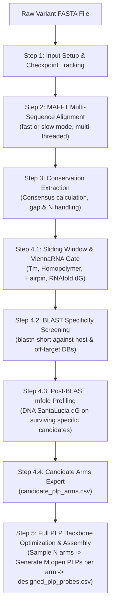
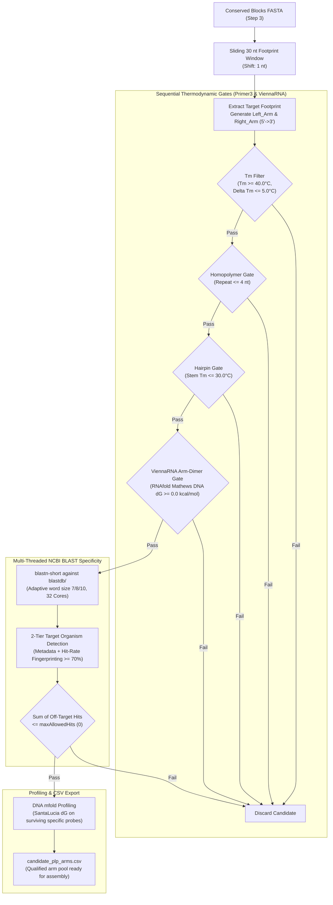
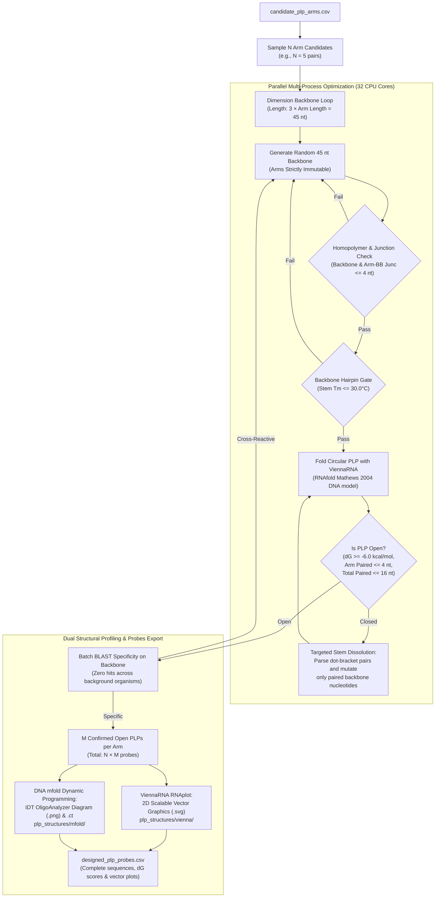

# pyPLP: Automated Padlock Probe Design & Screening Pipeline

**`pyPLP`** is a high-throughput, biophysically grounded Python package and automated pipeline designed to engineer highly specific **Padlock Probes (PLPs)** for pathogen diagnostics, viral genotyping, spatial transcriptomics, and Rolling Circle Amplification (RCA) assays.

---

## Table of Contents
1. [Scientific Rationale & Biophysical Principles](#scientific-rationale--biophysical-principles)
   - [What is a Padlock Probe (PLP)?](#what-is-a-padlock-probe-plp)
   - [1. Invariant Target Selection Across Strains](#1-invariant-target-selection-across-strains)
   - [2. Cation-Dependent Melting Temperature ($T_m$)](#2-cation-dependent-melting-temperature-t_m)
   - [3. Elimination of Homopolymers](#3-elimination-of-homopolymers)
   - [4. Suppression of Unimolecular Hairpins & Scaling Beyond 60 bp](#4-suppression-of-unimolecular-hairpins--scaling-beyond-60-bp)
   - [5. Decoupled Arm-Dimer Cross-Hybridization Screening](#5-decoupled-arm-dimer-cross-hybridization-screening)
   - [6. Elimination of Host and Background Off-Targets (BLAST)](#6-elimination-of-host-and-background-off-targets-blast)
   - [7. Ligase Fidelity & The 3' End Rule at the Ligation Junction](#7-ligase-fidelity--the-3-end-rule-at-the-ligation-junction)
   - [8. Multiplex Assay Architecture & Fixed Reference PLP Integration](#8-multiplex-assay-architecture--fixed-reference-plp-integration)
2. [Step-by-Step Pipeline Architecture](#step-by-step-pipeline-architecture)
   - [Step 1: Input Setup & Checkpoint Tracking](#step-1-input-setup--checkpoint-tracking)
   - [Step 2: MAFFT Multi-Sequence Alignment](#step-2-mafft-multi-sequence-alignment)
   - [Step 3: Conserved Regions Extraction](#step-3-conserved-regions-extraction)
   - [Step 4: Padlock Arm Screening & BLAST Specificity](#step-4-padlock-arm-screening--blast-specificity)
   - [Step 5: Full PLP Backbone Optimization, Arm Protection & Assembly](#step-5-full-plp-backbone-optimization-arm-protection--assembly)
3. [Configuration Reference (`config.json`)](#configuration-reference-configjson)
   - [Complete Configuration Schema](#complete-configuration-schema)
   - [Parameter Details Table](#parameter-details)
4. [Installation & Requirements](#installation--requirements)
   - [System Dependencies](#system-dependencies)
   - [Python Dependencies](#python-dependencies)
   - [Package Installation](#package-installation)
5. [Usage Guide](#usage-guide)
   - [Pipeline CLI Execution (`main.py`)](#cli-execution-mainpy)
   - [Resuming & Forcing Re-Execution](#resuming--forcing-re-execution)
   - [Standalone PLP Generator (`design_plp.py`)](#standalone-plp-generator-design_plppy)
   - [Standalone Multiplex Designer (`design_multiplex.py`)](#standalone-multiplex-designer-design_multiplexpy)
   - [In Silico Reaction Simulator (`simulate_plp.py`)](#in-silico-reaction-simulator-simulate_plppy)
   - [Programmatic Python API (`import pyPLP`)](#programmatic-python-api-import-pyplp)
6. [Package Structure](#package-structure)
7. [Output Specifications](#output-specifications)
   - [1. Candidate Arms Table (`candidate_plp_arms.csv`)](#1-candidate-arms-table-candidate_plp_armscsv)
   - [2. Designed PLP Probes Table (`designed_plp_probes.csv`)](#2-designed-plp-probes-table-designed_plp_probescsv)
   - [3. Secondary Structure Visualizations (`plp_structures/`)](#3-secondary-structure-visualizations-plp_structures)
   - [4. Multiplex Panel Probes Table (`multiplex_panel_probes.csv`)](#4-multiplex-panel-probes-table-multiplex_panel_probescsv)
   - [5. Pairwise Cross-Reactivity Matrix (`multiplex_cross_reactivity_matrix.csv`)](#5-pairwise-cross-reactivity-matrix-multiplex_cross_reactivity_matrixcsv)
   - [6. Multiplex Synthesis Order Sheet (`multiplex_oligos_order_sheet.csv`)](#6-multiplex-synthesis-order-sheet-multiplex_oligos_order_sheetcsv)
8. [Scientific References & Literature Citations](#8-scientific-references--literature-citations)

---

## Scientific Rationale & Biophysical Principles

### What is a Padlock Probe (PLP)?
A Padlock Probe is a long single-stranded oligonucleotide (~70–100 nt) composed of two target-complementary end segments (**Left Arm** and **Right Arm**) linked by a generic backbone sequence. When both arms hybridize juxtaposed to contiguous target DNA/RNA, a DNA or RNA ligase (such as T4 DNA ligase, Ampligase, or SplintR) covalently seals the nick between the 5'-phosphate and 3'-hydroxyl termini, circularizing the probe. 

Circularized probes are subsequently amplified by **Rolling Circle Amplification (RCA)** using phi29 DNA polymerase to generate long concatemeric amplicons with thousands of tandem repeats.

```
       [ Generic Backbone / Primer Binding Site ]
            /                                \
      5'--[Arm L]                         [Arm R]--3'
             |                               |
             V                               V
    3'--[Target L]-----------------------[Target R]--5'
                   ^ Junction (Nick)
```

Because ligation requires near-perfect base pairing at the junction, padlock probes provide single-nucleotide specificity. However, probe design must overcome multiple biological and physical hurdles:

### 1. Invariant Target Selection Across Strains
Viral genomes (e.g., Dengue, Chikungunya, Zika, Hepatitis B) mutate rapidly. Designing probes against variable regions causes diagnostic escape. `pyPLP` performs global/local multiple sequence alignment (MAFFT) across all known clinical variants and isolates to pinpoint contiguous sequence blocks that are strictly conserved across 100% (or a user-defined threshold) of target genomes.

### 2. Divalent Cation ($Mg^{2+}$) Dependent Melting Temperature ($T_m$)
Hybridization stability differs vastly between standard storage conditions ($0\text{ mM }Mg^{2+}$) and enzymatic reaction buffers ($1.5\text{–}10\text{ mM }Mg^{2+}$). Divalent magnesium ions screen the negatively charged phosphate backbones of DNA, neutralizing electrostatic repulsion and stabilizing the duplex.

- **Engine / Tool**: **`primer3-py`** ([`primer3.calc_tm`](https://libprimer3.github.io/))
- **Thermodynamic Model**: SantaLucia (1998) unified DNA nearest-neighbor parameters.
- **Parameters & Options Used**:
  - Uses native **Primer3 defaults** directly: `mv_conc = 50.0` ($50.0\text{ mM }Na^+$), `dv_conc = 1.5` ($1.5\text{ mM }Mg^{2+}$), `dntp_conc = 0.6` ($0.6\text{ mM}$), `dna_conc = 50.0` ($50.0\text{ nM}$), and `tm_method = "santalucia"`.
  - Baseline $0\text{ mM }Mg^{2+}$ (`*_Tm_0mM_Mg`) is evaluated with `dv_conc = 0.0, dntp_conc = 0.0`.
- **Formula**:
  $$T_m = \frac{\Delta H^\circ}{\Delta S^\circ + R \ln(C_{\text{oligo}} / 4)} - 273.15 + \text{salt correction}([\text{Na}^+], [\text{Mg}^{2+}])$$
- Ensuring arm $T_m \ge 40.0^\circ\text{C}$ guarantees rapid target binding kinetics at common ligation temperatures ($37^\circ\text{C}\text{ to }45^\circ\text{C}$).

### 3. Elimination of Homopolymers
Runs of identical nucleotides ($\ge 4$ nt, e.g., `AAAA`, `GGGG`) cause:
- **Polymerase slippage** during rolling circle amplification.
- Synthesis truncation and lower coupling efficiency during commercial solid-phase oligonucleotide manufacturing.
- Non-specific hybridization slipping across repetitive genomic regions.

### 4. Suppression of Unimolecular Hairpins & Scaling Beyond 60 bp
Before encountering target RNA/DNA, an arm must remain single-stranded and solvent-exposed. If an arm folds into a stable stem-loop hairpin ($T_m > 30^\circ\text{C}$), target hybridization is kinetically inhibited because the hairpin structure must first melt before target capture can occur.

- **Engine / Tool**: **`primer3-py`** ([`primer3.calc_hairpin`](https://libprimer3.github.io/))
- **Thermodynamic Model**: Unimolecular nearest-neighbor (SantaLucia 1998). Unlike bimolecular duplexes, unimolecular hairpin folding is concentration-independent ($T_m = \Delta H^\circ / \Delta S^\circ$).
- **Parameters Used**:
  - `mv_conc = 50.0` ($50.0\text{ mM }Na^+$), `dv_conc = 1.5` ($1.5\text{ mM }Mg^{2+}$), `dntp_conc = 0.6` ($0.6\text{ mM}$), `dna_conc = 50.0` ($50.0\text{ nM}$).
- **Dual Condition Gate**:
  - Primer3 will detect transient 2–3 bp hairpins with $T_m \approx 10\text{–}18^\circ\text{C}$. Rejecting these would unnecessarily disqualify great probes.
  - Therefore, `pyPLP` filters by checking:
    $$\text{Structure Found} == \text{"Yes"} \quad \text{AND} \quad T_m > \text{max\_hairpin\_tm} \ (30.0^\circ\text{C})$$
  - Weak hairpins ($\le 30^\circ\text{C}$) melt instantly at typical hybridization temperatures ($40\text{–}65^\circ\text{C}$) and are preserved.
- **Handling Sequences $> 60\text{ bp}$**:
  - Primer3's internal `thal` C library enforces a maximum sequence ceiling of 60 bp (`RuntimeError`).
  - For arms (15–25 nt) and standard backbones (45 nt), sequences are natively $\le 60\text{ bp}$.
  - For extended backbones ($> 60\text{ bp}$), `pyPLP` dynamically scans a **60-bp sliding window** across the sequence, identifying the most stable internal stem-loop without crashing.
  - For full-length circular padlock probes ($70\text{–}120+\text{ bp}$), `pyPLP` bypasses Primer3 entirely and folds the intact molecule using **ViennaRNA (`RNAfold`)** and **DNA `mfold`**, which have no length limits.

### 5. Decoupled Arm Dimer Cross-Hybridization Screening
The left arm and right arm are part of the same physical molecule or concentrated reaction mixture. If they hybridize to each other (heterodimerization), the probe cannot form the circular topology necessary for ligation:
- **Pre-BLAST (ViennaRNA `RNAfold` with `dna_mathews2004.par`)**: High-throughput in-memory evaluation of $\Delta G$ across all sliding windows.
  - *How ViennaRNA calculates $\Delta G$ in our pipeline*: `RNAfold` runs with `-P dna_mathews2004.par --noconv -T 37.0 --noPS`, loading SantaLucia/Mathews native single-stranded DNA nearest-neighbor thermodynamic parameters at $37^\circ\text{C}$. Using the Zuker-Stiegler dynamic programming algorithm, it decomposes the combined arm sequence (`Left_Arm + Right_Arm`) into additive structural motifs: stabilizing base-pair stacking ($\Delta G_{\text{stack}} < 0$) and destabilizing loop penalties ($\Delta G_{\text{loop}} > 0$). If the minimum free energy is negative ($\Delta G < 0\text{ kcal/mol}$), the arms would spontaneously hybridize to each other rather than target DNA/RNA, and the candidate window is discarded.
- **Post-BLAST (DNA `mfold`)**: Rigorous nearest-neighbor DNA SantaLucia folding on surviving candidates to profile structural stability in the final report.

### 6. Elimination of Host and Cross-Viral Off-Targets (BLAST)
Probes used in clinical blood, plasma, or tissue samples must not cross-hybridize to the host genome (e.g., Human GRCh38) or co-circulating related pathogens (e.g., Dengue serotypes 1–4, Zika virus, Chikungunya). Contiguous candidate probe footprints ($2 \times \text{arm length}$, e.g., 30 nt) are queried against local NCBI nucleotide databases using `blastn-short` with adaptive word sizes.

### 7. Ligase Fidelity & The 3' End Rule at the Ligation Junction
Padlock probe circularization requires the formation of a phosphodiester bond catalyzed by a DNA ligase (e.g., *Ampligase*, *T4 DNA Ligase*, or *SplintR Ligase*) between the **$3'\text{-OH}$ terminus of the Right Arm** and the **$5'\text{-PO}_4$ terminus of the Left Arm**.

```
                           Ligation Nick Junction
                                     ▼
Left Arm (5'-PO4)  ───[ 5'-PO4 N N N N ... 3' ][ ... N N N N 3'-OH ]─── Right Arm (3'-OH)
Target RNA/DNA     ───[ 3' ... N' N' N' N'    ][     N' N' N' N' ... 5' ]───
                                     ▲               ▲
                           Position +1 (5' Base)    Position -1 (3' Base)
```

- **Extreme Asymmetry of Ligase Proofreading**: DNA ligases exhibit profound discrimination against mismatches at the $3'$ terminus (position $-1$ from the nick). Seminal studies (*Barany 1991*, *Nilsson et al. 1994*, *Luo et al. 1996*) demonstrated that a single mismatch at the $3'$ base decreases ligation efficiency by $10^2$ to $10^5$-fold, essentially abolishing circularization. Conversely, mismatches on the $5'$ side or internal positions ($\ge \pm 3\text{ nt}$) have significantly weaker catalytic discrimination.
- **Relationship to `blastMinIdentity`**:
  - For short probe arms ($13\text{–}18\text{ nt}$), setting `blastMinIdentity: 90.0` is overly permissive because an off-target with $2$ mismatches on a $15\text{ nt}$ arm has $86.7\%$ identity and would escape detection.
  - Literature standards (*OligoArray*, *AutoPLP*) recommend **`75.0%` to `80.0%`** minimum identity for diagnostic specificity.
  - Strict BLAST filtering ($75\text{–}80\%$) protects against both false-positive circularization and probe sequestration/titration, where probes bind off-targets and fail to detect the pathogen.

#### Option A: Ligation Junction Quality Filter (Intra-Probe)
- **Purpose**: Evaluates the thermodynamic stability and structural competence of the probe ends that meet at the ligation nick.
- **Biochemical Rationale**:
  1. *Anti-Fraying / Stacking Stability*: At isothermal reaction temperatures ($37^\circ\text{C}\text{–}60^\circ\text{C}$), terminal A/T base pairs undergo rapid breathing/fraying. Requiring at least one G or C at the junction (`min_gc_at_junction: 1`) and limiting terminal A/T repeat runs (`max_terminal_at_run: 2`) ensures the $3'$ terminus remains tightly locked into the ligase catalytic pocket.
  2. *Suppression of Target-Independent Self-Ligation*: If the $3'$ terminus of the Right Arm and $5'$ terminus of the Left Arm possess reverse-complementary sequences, the probe can form an autonomous self-dimer and ligate *without* the target, producing false-positive background.
- **Usage**: Enable in `config.json`:
  ```json
  "ligation_junction_filter": {
    "enabled": true,
    "min_gc_at_junction": 1,
    "max_terminal_at_run": 2,
    "check_nick_dimer": true,
    "max_nick_dimer_bp": 3
  }
  ```

#### Option B: Ligase Footprint & 3' Mismatch Evaluation (Off-Target Analysis)
- **Purpose**: Differentiates between off-target BLAST hits that can actually circularize versus those that are enzymatically dead due to a $3'$ junction mismatch.
- **Biochemical Rationale**:
  - If a background sequence (e.g. in human DNA) has $80\%$ homology across the arm footprint but contains a **mismatch at position $-1$ (the $3'$ nick base)**, DNA ligase *cannot* seal the nick. The hit is **`Ligation_Incompetent`**.
  - Conversely, an alignment that spans the junction with **100% complementarity at the $3'$ base** is **`Ligation_Competent`** and presents a genuine threat of false-positive circularization.
- **Usage**:
  - *Reporting Mode (Default with Option B)*: Keeps current strict BLAST screening active, but classifies and annotates `Ligation_Competent_Hits_<DB>` in `candidate_plp_arms.csv` for transparent risk profiling.
  - *Rescue Mode*: Set `"rescue_3prime_mismatches": true` to rescue candidate arms whose off-target hits are all ligation-incompetent (ideal when screening against dense, homologous genomes where strict BLAST eliminates all candidate arms).
  ```json
  "ligase_footprint_filter": {
    "enabled": true,
    "rescue_3prime_mismatches": false
  }
  ```

### 8. Multiplex Assay Architecture & Fixed Reference PLP Integration

In multiplex diagnostic assays (such as multi-line lateral flow strips or multi-channel fluorometry), multiple pathogen targets are detected concurrently in a single isothermal reaction tube without optical cross-talk, cross-priming, or false-positive circularization.

```
       [ Target 1 Concatemer ] ---------------> Binds Universal Detection Probe (5'-FAM)
       [ Target 2 Concatemer ] ---------------> Binds Universal Detection Probe (5'-FAM)

       [ Target 1 PLP Circle ] --- Primed by ---> RCA Primer 1 (5'-Biotin)  ---> Captured on Test Line 1 (Streptavidin)
       [ Target 2 PLP Circle ] --- Primed by ---> RCA Primer 2 (5'-DIG)     ---> Captured on Test Line 2 (Anti-DIG)
       [ Target 3 PLP Circle ] --- Primed by ---> RCA Primer 3 (5'-TAMRA)   ---> Captured on Test Line 3 (Anti-TAMRA)
```

#### Shared Reporter Chemistry & Channel Separation
- **Universal Detection Probe (5'-FAM)**: A single universal probe sequence (e.g. `CCTGATCAACACTTC`) binds to all extended RCA concatemers across all channels.
- **Channel-Specific RCA Amplification Primers**: Each channel receives a uniquely barcoded, mutually orthogonal RCA primer bearing a distinct hapten/fluorophore modification (`5'-Biotin`, `5'-DIG`, `5'-TAMRA`, `5'-Cy5`). The primer sequence dictates which target circle is amplified and where the concatemer is captured.

#### Multiplex Expansion with Pre-Existing Fixed PLPs
Diagnostic assay developers frequently already possess a validated, pre-manufactured padlock probe in the laboratory:
- **Fixed PLP**: `ATACCTGCTTCTGTTCTACCTATCCGTGAAACCGTCCTCCTGATCAACACTTCGAGTTACTTTGCGCGACTG`
- **Fixed RCA Primer**: `CGGTTTCACGGATAG` (Channel 1, 5'-Biotin)
- **Universal Detection Probe**: `CCTGATCAACACTTC` (Universal, 5'-FAM)

When expanding the assay into a multiplex panel (e.g. adding Dengue or Zika to an existing Chikungunya assay):
- Developers input the **Left Arm** and **Right Arm** of the new target.
- The pipeline preserves the universal detection probe and designs a new orthogonal RCA primer and open backbone for Channel 2 (`5'-DIG`).
- **Zero Cross-Reactivity Gates with Fixed Oligos**:
  1. *Anti-Cross-Priming Gate ($\Delta G \ge -2.0\text{ kcal/mol}$)*: The new RCA primer (Channel 2) must NOT bind to the fixed PLP (Channel 1), and the fixed RCA primer (Channel 1) must NOT bind to the new PLP (Channel 2).
  2. *Inter-PLP Hybridization Gate ($\Delta G \ge -6.0\text{ kcal/mol}$)*: The new PLP must not form stable duplexes with the fixed PLP in the annealing mixture.
  3. *Universal Probe Non-Interference Gate ($\Delta G \ge -2.0\text{ kcal/mol}$)*: The universal probe must not cross-dimerize with new target arms or new RCA primers.
  4. *Complete $N \times N$ Matrix Verification*: Validates all pairwise combinations and produces an oligo order sheet distinguishing what is already in hand from what needs to be ordered.

---

## Step-by-Step Pipeline Architecture



### Step 1: Input Setup & Checkpoint Tracking
The pipeline initializes the job directory and creates a persistent `.checkpoints/` state directory. Each completed step generates a cryptographically verified JSON receipt. If a run is interrupted or aborted, re-running the command automatically resumes from the last completed step without repeating expensive computations (override with `--force`).

### Step 2: MAFFT Alignment
Executes MAFFT inside a specified conda environment (`mafft_env`).
- **`fast` mode**: `--auto` heuristic algorithm, ideal for large collections of long genomes.
- **`slow` mode**: `--localpair --maxiterate 1000`, performing iterative refinement for diverged sequences.

### Step 3: Conserved Regions Extraction
Analyzes each alignment position across all sequences:
- **Consensus & Conservation**: Calculates the most frequent nucleotide and percentage agreement:
  $$\text{Conservation \%} = \frac{\text{Count of Consensus Nucleotide}}{\text{Total Sequences Evaluated}} \times 100$$
- **Gap Handling (`ignore_gaps`)**:
  - When `false` (recommended), gap characters (`-`, `.`) count in the denominator, ensuring selected blocks have zero insertion/deletion indels across target strains.
  - When `true`, gaps are ignored, scoring conservation only among sequences possessing a base.
- **Ambiguity Code Handling (`N`)**:
  - Ambiguous characters like `N` are penalized during conservation scoring.
  - Any candidate window containing `N` or non-ACGT bases is strictly excluded in Step 4 to prevent synthesis errors and Primer3 calculation failures.
- Outputs contiguous blocks meeting `min_block_len_bp` and `min_conservation_pct` in both positional and size-sorted FASTA formats.

### Step 4: Padlock Arm Screening



1. **Sliding Window Scanning (4.1)**:
   - Evaluates footprints spanning $2 \times \text{arm\_len}$ (e.g., $2 \times 15 = 30\text{ nt}$) shifted 1 nucleotide at a time.
   - Slices left and right target regions and computes their reverse complements (`Left_Arm` and `Right_Arm`).
   - Filters by minimum $T_m$ under $1.5\text{ mM }Mg^{2+}$.
   - Filters by maximum homopolymer run length.
   - Filters by unimolecular hairpin stability.
   - Filters by arm heterodimer formation using fast ViennaRNA $\Delta G$.
2. **BLAST Specificity Screening (4.2)**:
   - **Automatic Database Discovery & On-the-Fly Indexing**: Automatically discovers all organisms in `blastdbDir`. It checks for pre-indexed database subfolders (`*.nin`, `*.nhr`), direct index files, and unindexed raw FASTA files (`*.fasta`, `*.fa`, `*.fna`). Any new organism FASTA dropped into `blastdb/` is automatically indexed using `makeblastdb` on the fly without manual intervention.
   - **Automated On-Target Organism Detection**: To prevent on-target binding from being falsely penalized as an off-target match, the pipeline dynamically detects which database is the target organism using a 2-tier strategy:
     - *Tier 1 (Context & Metadata Matching)*: Checks optional `"target_organism"` in `config.json`, the input FASTA path/filename (e.g. `sequences_chikv.fasta`), sequence headers, and job setup receipts.
     - *Tier 2 (Biological Hit-Rate Fingerprinting)*: If not in metadata, evaluates candidate match rates across all queried databases. Because candidate probes were extracted from the target genome, the true on-target database achieves nearly $100\%$ candidate match rate ($\ge 70\%$), whereas off-target background databases match $< 2\%$. If the target organism is not in `blastdb/`, all databases are correctly treated as off-targets.
   - **Single Unified `maxAllowedHits` Threshold**: Rather than maintaining a verbose dictionary for every database, `maxAllowedHits` accepts a single integer (e.g. `0`). The pipeline sums all matches across all off-target background organisms:
     $$\text{Total Off-Target Hits} = \sum_{\text{DB} \in \text{background}} \text{Hits}_{\text{DB}}$$
     Candidate probes with $\text{Total Off-Target Hits} > \text{maxAllowedHits}$ are rejected.
   - Dynamically selects optimal BLAST word sizes (7, 8, or 10) based on query footprint length.
   - Executes `blastn-short` across available CPU threads against local databases (`blastdb/`).
3. **Post-BLAST DNA `mfold` Profiling (4.3)**:
   - For the surviving specific candidates, executes `mfold` to calculate DNA minimum free energy ($\Delta G_{\text{mfold}}$).
4. **Candidate Arms Export (4.4)**:
   - Writes qualified arm pairs to `candidate_plp_arms.csv` with biophysical metrics and BLAST match counts.

### Step 5: Full PLP Backbone Optimization, Arm Protection & Assembly



1. **Random Arm Sampling (5.1)**:
   - Randomly samples $N$ candidate arm pairs from `candidate_plp_arms.csv` (configured via `sample_arms_count`).
2. **Stochastic Backbone Optimization & Stem Dissolution (5.2)**:
   - For each chosen arm pair, stochastically generates and optimizes synthetic backbone sequences ($3 \times \text{arm length}$, e.g. 45 nt for 15 nt arms) across available CPU cores.
   - **Arm Invariance & Protection**: The target-hybridizing arms (`Left_Arm` and `Right_Arm`) are **strictly immutable**. Only nucleotides located in the central connector backbone are mutated.
   - **Targeted Stem Dissolution**: Evaluates candidate secondary structures using high-speed in-memory **ViennaRNA (`RNAfold`)** with Mathews 2004 DNA parameters. When internal stems form, it parses dot-bracket pairs and applies non-complementary point mutations specifically to paired backbone residues to dissolve the fold.
   - Enforces openness gates: full PLP $\Delta G \ge \text{min\_plp\_mfe\_dg}$ ($-6.0\text{ kcal/mol}$), maximum paired arm bases $\le 4$ nt, and maximum total paired bases $\le 16$ nt.
3. **Backbone Specificity Screening (5.3)**:
   - Assesses generated backbones against all background databases in `blastdb/` using `blastn-short`, enforcing zero off-target matches (`maxAllowedHits: 0`).
4. **Dual-Engine Structural Profiling & Vector Rendering (5.4)**:
   - Automatically generates vector SVG secondary structure plots using ViennaRNA (`RNAplot`) saved in `plp_structures/vienna/`.
   - Profiles final confirmed probes with **DNA `mfold`** (Zuker dynamic programming) to record the IDT-compatible $\Delta G_{\text{mfold}}$ in the output CSV, saving structure diagrams in `plp_structures/mfold/`.
   - When `keep_ct_ps: false`, intermediate `.ct` and `.ps` files are cleaned up; when `true`, they are preserved for downstream analysis.
5. **Full PLP Export (5.5)**:
   - Writes $M$ open PLP probes per arm to `designed_plp_probes.csv`.

---

## Configuration Reference (`config.json`)

### Complete Configuration Schema

```json
{
  "alignment": {
    "mafft_env": "mafft_env",
    "mafft_mode": "fast",
    "mafft_threads": 8,
    "min_conservation_pct": 100.0,
    "min_block_len_bp": 30,
    "ignore_gaps": false
  },
  "arm_design": {
    "armLengths": [15],
    "filter_by_tm": true,
    "min_tm": 40.0,
    "filter_by_homopolymer": true,
    "maxHomopolymer": 4,
    "filter_by_hairpin": true,
    "max_hairpin_tm": 30.0,
    "filter_by_arm_dimer": true,
    "max_arm_dimer_dg": -1.0,
    "blastdbDir": "blastdb",
    "threads": 32,
    "blastMinIdentity": 75.0,
    "maxAllowedHits": 0,
    "ligation_junction_filter": {
      "enabled": false,
      "min_gc_at_junction": 1,
      "max_terminal_at_run": 2,
      "check_nick_dimer": true,
      "max_nick_dimer_bp": 3
    },
    "ligase_footprint_filter": {
      "enabled": false,
      "rescue_3prime_mismatches": false
    }
  },
  "plp_generation": {
    "enabled": true,
    "sample_arms_count": 5,
    "plp_per_arm": 5,
    "backbone_length_factor": 3,
    "min_plp_mfe_dg": -6.0,
    "max_paired_arm_bases": 4,
    "max_paired_total_bases": 16,
    "structures_dir": "plp_structures",
    "keep_ct_ps": false
  },
  "multiplex": {
    "target_channels": 3,
    "max_cross_dimer_dg": -2.0,
    "channel_labels": ["5'-Biotin", "5'-DIG", "5'-TAMRA"],
    "universal_detection_probe": "",
    "fixed_oligos": ""
  }
}
```

### Parameter Details

| Section | Parameter | Type | Default | Scientific Description & Purpose |
| :--- | :--- | :--- | :--- | :--- |
| **`alignment`** | `mafft_env` | string | `"mafft_env"` | Name of the Conda environment where MAFFT is installed. |
| | `mafft_mode` | string | `"fast"` | Alignment mode: `"fast"` (`--auto`) or `"slow"` (`--localpair --maxiterate 1000`). |
| | `mafft_threads` | integer | `8` | Number of CPU cores allocated for MAFFT alignment. |
| | `min_conservation_pct` | float | `100.0` | Minimum column conservation percentage required across aligned variants. |
| | `min_block_len_bp` | integer | `30` | Minimum length (bp) for contiguous conserved blocks (must be $\ge 2 \times \text{arm length}$). |
| | `ignore_gaps` | boolean | `false` | When `false`, gaps count toward length, penalizing indels. When `true`, gaps are ignored. |
| **`arm_design`** | `armLengths` | list/int | `[15]` or `[12, 20]` | Specific arm size (nt) or range interval to test. Total footprint is $2 \times \text{armLength}$. |
| | `filter_by_tm` | boolean | `true` | Enables or disables melting temperature gate. |
| | `min_tm` | float | `40.0` | Minimum melting temperature ($^\circ\text{C}$) required for each probe arm. |
| | `filter_by_homopolymer` | boolean | `true` | Enables or disables homopolymer filtering. |
| | `maxHomopolymer` | integer | `4` | Maximum allowable repeating identical bases (e.g., 4 rejects `AAAA`). |
| | `filter_by_hairpin` | boolean | `true` | Enables or disables unimolecular hairpin check. |
| | `max_hairpin_tm` | float | `30.0` | Maximum permissible melting temperature ($^\circ\text{C}$) for internal arm stem-loops. |
| | `filter_by_arm_dimer` | boolean | `true` | Enables or disables arm-dimer cross-hybridization filtering. |
| | `max_arm_dimer_dg` | float | `0.0` | Minimum free energy threshold ($\Delta G$ in kcal/mol). Values $< \text{threshold}$ are rejected. |
| | `blastdbDir` | string | `"blastdb"` | Directory containing indexed NCBI BLAST nucleotide databases (`.nin`, `.nhr`). |
| | `threads` | integer | `32` | Number of CPU cores used for parallel BLAST and sliding window evaluation. |
| | `blastMinIdentity` | float | `75.0` | Sequence identity threshold (%) to flag an off-target alignment match. |
| | `target_organism` | string | `null` | *(Optional)* Target organism name (e.g. `"CHIKV"`). Automatically inferred from input filename or $\ge 70\%$ match rate if omitted. |
| | `maxAllowedHits` | integer | `0` | Maximum allowable total sum of off-target matches across all background organisms in `blastdb` (`0` enforces absolute zero cross-reactivity). |
| | `ligation_junction_filter.enabled` | boolean | `false` | *(Option A)* Enables intra-probe nick junction quality filter (terminal stacking & nick self-dimer check). |
| | `ligation_junction_filter.min_gc_at_junction` | integer | `1` | *(Option A)* Minimum required G/C count across the two nick-flanking bases to prevent thermal fraying. |
| | `ligation_junction_filter.max_terminal_at_run` | integer | `2` | *(Option A)* Maximum allowable consecutive A/T repeat length at the 3' terminus of the right arm. |
| | `ligation_junction_filter.check_nick_dimer` | boolean | `true` | *(Option A)* Checks and filters out probe ends that form complementary self-dimers across the nick. |
| | `ligase_footprint_filter.enabled` | boolean | `false` | *(Option B)* Enables ligase footprint & 3' mismatch classification on off-target BLAST hits. |
| | `ligase_footprint_filter.rescue_3prime_mismatches` | boolean | `false` | *(Option B)* When `true`, rescues candidate arms whose off-target BLAST hits contain a 3' junction mismatch. |
| **`plp_generation`** | `enabled` | boolean | `true` | Enables or disables Step 5 automated full PLP assembly. |
| | `sample_arms_count` | integer | `5` | Number ($N$) of random candidate arm pairs to sample from `candidate_plp_arms.csv`. |
| | `plp_per_arm` | integer | `5` | Number ($M$) of open, optimized PLP probes to design per sampled arm pair. |
| | `backbone_length_factor` | integer | `3` | Multiplier for backbone size relative to average arm length ($3 \times \text{arm length}$). |
| | `min_plp_mfe_dg` | float | `-6.0` | Minimum allowable free energy floor ($\Delta G$ in kcal/mol) for the assembled PLP molecule (evaluated via `RNAfold` with Mathews DNA parameters). |
| | `max_paired_arm_bases` | integer | `4` | Maximum allowable bases paired within each hybridizing arm. |
| | `max_paired_total_bases` | integer | `16` | Maximum allowable total paired bases across the entire circular probe topology. |
| | `structures_dir` | string | `"plp_structures"` | Directory where 2D vector plots (Vienna SVG) and mfold secondary structures are stored. |
| | `keep_ct_ps` | boolean | `false` | When `true`, preserves raw `.ct` and `.ps` files from `mfold`. |
| **`multiplex`** | `target_channels` | integer | `3` | Number of distinct multiplex detection channels. |
| | `max_cross_dimer_dg` | float | `-2.0` | Maximum allowable cross-dimer binding free energy ($\Delta G$ in kcal/mol) between any non-cognate oligos. |
| | `channel_labels` | list | `["5'-Biotin", "5'-DIG", ...]` | Reporter labels / haptens assigned to channel RCA primers. |
| | `universal_detection_probe` | string | `""` | Optional predefined universal detection probe sequence (5'-FAM labeled). |
| | `fixed_oligos` | string | `""` | Optional path to CSV containing pre-existing fixed reference oligos (`PLP,seq`, `RCA_Primer,seq`, `PLP_Detection_Probe,seq`). |

### Pre-Built Configuration Templates (`configs/`)

Ready-to-use configuration files tailored for specific assay modalities are provided in `configs/`:

| Config File | Target Channels | Key Modality / Features | Recommended Use Case |
| :--- | :---: | :--- | :--- |
| **[`configs/config_singleplex.json`](file:///home/bionanosense/soash/PLP/configs/config_singleplex.json)** | 1 | Singleplex, dynamic reporter, open PLP folding ($\Delta G \ge -2.0$). | Standard single-pathogen diagnostics. |
| **[`configs/config_mtb_singleplex.json`](file:///home/bionanosense/soash/PLP/configs/config_mtb_singleplex.json)** | 1 | MTB singleplex ($15\text{ nt}$ arms, $T_m \ge 45^\circ\text{C}$, $\Delta G \ge -2.0$). | Mycobacterium tuberculosis (MTB) singleplex PLP & lateral flow assay. |
| **[`configs/config_duplex.json`](file:///home/bionanosense/soash/PLP/configs/config_duplex.json)** | 2 | 2-channel multiplex (`5'-Biotin`, `5'-DIG`), BstUI restriction site (`CGCG`). | Co-infection assays or Target + Internal Control. |
| **[`configs/config_triplex_universal_probe.json`](file:///home/bionanosense/soash/PLP/configs/config_triplex_universal_probe.json)** | 3 | 3-channel triplex (`5'-Biotin`, `5'-DIG`, `5'-TAMRA`), fixed Universal Detection Probe (`CCTGATCAACACTTC`). | Triplex panels sharing 1 universal FAM detection probe. |
| **[`configs/config_multiplex_fixed_oligos.json`](file:///home/bionanosense/soash/PLP/configs/config_multiplex_fixed_oligos.json)** | 2+ | Fixed reference set integration (`configs/fixed_reference_set.csv`), anti-cross-priming gate ($\Delta G \ge -2.0$). | Expanding an existing validated working probe with new targets. |
| **[`configs/config_high_fidelity_junction.json`](file:///home/bionanosense/soash/PLP/configs/config_high_fidelity_junction.json)** | 1 | Option A (ligation junction quality) & Option B (ligase footprint & 3' mismatch profiling) active. | High-fidelity SNP, point mutation, or strain genotyping. |

#### Usage Examples:
```bash
# 1. Run MTB singleplex PLP design from predefined Left and Right arms:
python design_plp.py \
  -j mtb_singleplex_plp \
  --left-arm CAAGACATGCATCCC \
  --right-arm AAGCGCTTTCCACCA \
  -c configs/config_mtb_singleplex.json

# 2. Run Triplex assay with fixed universal FAM probe:
python main.py -j triplex_assay -c configs/config_triplex_universal_probe.json -f target1.fasta target2.fasta target3.fasta

# 3. Design a new PLP to multiplex with an existing fixed reference set:
python design_multiplex.py -j new_target_assay -c configs/config_multiplex_fixed_oligos.json --left-arm GATGTTTCTGTCCAG --right-arm CCCGATCTTTCCAGA

# 4. High-fidelity SNP / strain discrimination:
python main.py -j snp_assay -c configs/config_high_fidelity_junction.json -f pathogen_variants.fasta
```

---

## Installation & Requirements

### System Dependencies
- Linux (Ubuntu 20.04+ recommended)
- `conda` or `miniconda`
- External scientific tools (in PATH):
  - NCBI BLAST+ (`blastn`, `makeblastdb`)
  - MAFFT (within specified conda environment)
  - ViennaRNA (`RNAfold`)
  - Optional: `mfold`, `sir_graph`, Ghostscript (`gs`)

### Python Dependencies
- Python $\ge 3.8$
- `biopython >= 1.79`
- `primer3-py >= 0.6.0`

### Package Installation
Install `pyPLP` in editable mode inside your conda environment:
```bash
conda activate base
pip install -e .
```

---

## Usage Guide

### CLI Execution (`main.py`)

Run the complete 5-step pipeline using [main.py](file:///home/bionanosense/soash/PLP/main.py):
```bash
python main.py -j my_dengue_job -f input/sequences.fasta -c config.json
```

#### Pipeline CLI Options (`main.py`)

| Flag | Description | Default |
| :--- | :--- | :--- |
| `-j`, `--job-name` | **(Required)** Job name. Outputs are automatically organized under `results/<job_name>/`. | *None* |
| `-f`, `--fasta` | **(Required)** Path to one or more input FASTA files. Provide multiple files (e.g. `-f hcv.fa hbv.fa chikv.fa`) to trigger the automated **Multi-Pathogen Multiplex Pipeline**. | *None* |
| `-c`, `--config` | Path to unified JSON configuration file. | `"config.json"` |
| `-p`, `--min-conservation` | Initial target conservation percentage (e.g. `-p 100.0`). If 100% blocks are not found, automatically decrements step-by-step. | `100.0` (from `config.json`) |
| `-m`, `--multiplex` | Assemble an orthogonal multiplex panel across $K$ distinct targets (e.g. `-m 3`). | From `config.json` |
| `--force` | Ignore existing receipts in `.checkpoints/` and force re-execution of all steps from scratch. | `false` |

### Resuming & Forcing Re-Execution

If interrupted, re-running the same command resumes automatically from the last completed step:
```bash
python main.py -j my_dengue_job -f input/sequences.fasta -c config.json
```

To force re-execution of all steps from scratch (ignoring cached receipts in `.checkpoints/`):
```bash
python main.py -j my_dengue_job -f input/sequences.fasta -c config.json --force
```

### Standalone PLP Generator (`design_plp.py`)

To generate open, non-cross-reactive padlock probes for custom **Left and Right Arm** sequences directly outside the pipeline, saving all results into a designated job directory:

```bash
# Basic usage with Job Name, Left Arm, and Right Arm:
python design_plp.py \
  -j my_custom_job \
  --left-arm TATTGAAGAAGCCGC \
  --right-arm CTTTCATCTGCATCA

# MTB Singleplex with dedicated configuration:
python design_plp.py \
  -j mtb_singleplex_plp \
  --left-arm CAAGACATGCATCCC \
  --right-arm AAGCGCTTTCCACCA \
  -c configs/config_mtb_singleplex.json

# With custom probe count and backbone length:
python design_plp.py \
  -j my_custom_job \
  -l TATTGAAGAAGCCGC \
  -r CTTTCATCTGCATCA \
  -n 5 \
  --backbone-len 45
```

#### Standalone CLI Options (`design_plp.py`)

| Flag | Description | Default |
| :--- | :--- | :--- |
| `-j`, `--job-name` | **(Required)** Job name. Probes CSV and structure plots are saved under `results/<job_name>/`. | *None* |
| `-l`, `--left-arm` | **(Required)** 5' capture arm sequence ($5' \rightarrow 3'$). | *None* |
| `-r`, `--right-arm` | **(Required)** 3' capture arm sequence ($5' \rightarrow 3'$). | *None* |
| `-n`, `--count` | Number of open, non-cross-reactive PLP probes to generate. | `5` |
| `-b`, `--backbone-len` | Custom backbone length in nt. | $3 \times \text{average arm length}$ |
| `-o`, `--output-csv` | Custom CSV filename inside the job directory. | `"designed_plp_probes.csv"` |
| `-s`, `--structures-dir` | Custom secondary structures folder inside the job directory. | `"plp_structures"` |
| `--skip-blast` | Skip BLAST screening against background databases (pure thermodynamic design). | `false` |
| `--blastdb` | Path to directory containing indexed NCBI BLAST nucleotide databases. | `"blastdb"` |
| `-t`, `--threads` | Number of parallel CPU worker cores to allocate. | All available cores |
| `-c`, `--config` | Optional JSON config to inherit thermodynamic gates and background thresholds. | `"config.json"` |
| `--keep-ct-ps` | Preserve raw `.ct` connectivity tables and `.ps` files from DNA mfold. | `false` |
| `-p`, `--prefix` | Identifier prefix for generated probes (e.g. `Custom_PLP_1`). | `"Custom_PLP"` |

### Standalone Multiplex Designer (`design_multiplex.py`)

To engineer fully orthogonal, non-cross-reactive multiplex panels (Triplex or $K$-plex) directly, or expand an **existing fixed reference PLP / oligo set**:

```bash
# Option 1: Direct target definitions via CLI:
python design_multiplex.py \
  -j my_triplex_job \
  --targets "HCV:CACTATGGCTCTCCC:ACCGGTTCCGCAGAC,HBV:ACCACGAGTCTAGAC:AATTGAGAGAAGTCC,CHIKV:GATGTTTCTGTCCAG:CCCGATCTTTCCAGA" \
  --labels "5'-Biotin,5'-DIG,5'-TAMRA"

# Option 2: Target input via CSV file:
python design_multiplex.py \
  -j my_triplex_job \
  -t input/triplex_example.csv \
  --max-cross-dimer-dg -2.0

# Option 3: Designing a new PLP to multiplex with a PRE-EXISTING FIXED PLP SET:
# Input the new target's Left/Right arms and supply the fixed reference set:
python design_multiplex.py \
  -j my_fixed_multiplex_job \
  --left-arm GATGTTTCTGTCCAG \
  --right-arm CCCGATCTTTCCAGA \
  --target-name CHIKV_Target \
  --fixed-plp ATACCTGCTTCTGTTCTACCTATCCGTGAAACCGTCCTCCTGATCAACACTTCGAGTTACTTTGCGCGACTG \
  --fixed-rca-primer CGGTTTCACGGATAG \
  --universal-detection-probe CCTGATCAACACTTC

# Or pass the fixed set via a CSV file (PLP, RCA_Primer, PLP_Detection_Probe):
python design_multiplex.py \
  -j my_fixed_multiplex_job \
  --left-arm GATGTTTCTGTCCAG \
  --right-arm CCCGATCTTTCCAGA \
  --target-name CHIKV_Target \
  --fixed-oligos fixed_oligos.csv
```

#### Fixed Oligo CSV Format
When using `--fixed-oligos fixed_oligos.csv`, the file can be formatted as key-value lines:
```csv
PLP,ATACCTGCTTCTGTTCTACCTATCCGTGAAACCGTCCTCCTGATCAACACTTCGAGTTACTTTGCGCGACTG
RCA_Primer,CGGTTTCACGGATAG
PLP_Detection_Probe,CCTGATCAACACTTC
```
*(The fixed channel is automatically assigned to Channel 1, `5'-Biotin`, and the newly designed target is assigned Channel 2, `5'-DIG`, with guaranteed zero cross-reactivity with the fixed probe and primer).*

#### Standalone Multiplex CLI Options (`design_multiplex.py`)

| Flag | Description | Default |
| :--- | :--- | :--- |
| `-j`, `--job-name` | **(Required)** Job name. Probes, matrix, and order sheets are saved under `results/<job_name>/`. | *None* |
| `--left-arm` | Left arm sequence ($5' \rightarrow 3'$) for a new single target. | *None* |
| `--right-arm` | Right arm sequence ($5' \rightarrow 3'$) for a new single target. | *None* |
| `--target-name` | Name for the new target (used with `--left-arm` and `--right-arm`). | `"Target_New"` |
| `--fixed-oligos` | Path to CSV or string containing fixed reference oligos (`PLP,seq`, `RCA_Primer,seq`, `PLP_Detection_Probe,seq`). | *None* |
| `--fixed-plp` | Pre-existing fixed circularizing padlock probe sequence ($5' \rightarrow 3'$). | *None* |
| `--fixed-rca-primer` | Pre-existing fixed RCA amplification primer sequence. | *None* |
| `--fixed-label` | Reporter modification label for the fixed RCA primer. | `"5'-Biotin"` |
| `--universal-detection-probe` | Fixed universal detection probe sequence (5'-FAM labeled, shared across all channels). | Dynamic |
| `--targets` | Inline comma-separated target specifications formatted as `Name:LeftArm:RightArm,...`. | *None* |
| `-t`, `--targets-csv` | Path to CSV containing target definitions (`Name,Left_Arm,Right_Arm`). | *None* |
| `--labels` | Comma-separated reporter labels for RCA primers (e.g. `5'-Biotin,5'-DIG,5'-TAMRA,5'-Cy5`). | `5'-Biotin,5'-DIG,5'-TAMRA...` |
| `--max-cross-dimer-dg` | Heterodimer $\Delta G$ threshold (kcal/mol) for screening probe-probe and primer-probe cross-reactivity. | `-2.0` |
| `--restriction-site` | Optional restriction cleavage motif (e.g. `BstUI`, `EcoRV`, or `CGCG`) embedded into PLP backbone. | *None* |
| `-c`, `--config` | Path to configuration JSON file. | `"config.json"` |
| `--keep-ct-ps` | Preserve raw `.ct` connectivity tables and `.ps` files from DNA mfold. | `false` |

### In Silico Reaction Simulator (`simulate_plp.py`)

Simulate and visualize how target RNA/DNA, padlock probes, RCA primers, and detection probes hybridize and react *in silico*, before running wet-lab assays. Provides both terminal ASCII base-pairing ladders and interactive standalone HTML reports:

```bash
# Basic simulation via CLI arguments:
python simulate_plp.py \
  --target "ATCGATCGATGGGATGCATGTCTTGTGGTGGAAAGCGCTTCTAGCTAGCT" \
  --plp "CAAGACATGCATCCCTAAGCATAACAGCCCACCACTATGTAACCTCTAGACAACCTCCTAAGCGCTTTCCACCA" \
  --rca-primer "TAGTGGTGGGCTGTTATG" \
  --probe "AACCTCTAGACAACCTCC" \
  -j my_simulation_job \
  -T 37.0

# RNA target validation:
python simulate_plp.py \
  --target "AUCGAUCGAUGGGAUGCAUGUCUUGUGGUGGAAAGCGCUUCUAGCUAGCU" \
  --plp "CAAGACATGCATCCCTAAGCATAACAGCCCACCACTATGTAACCTCTAGACAACCTCCTAAGCGCTTTCCACCA" \
  --rca-primer "TAGTGGTGGGCTGTTATG" \
  --probe "AACCTCTAGACAACCTCC" \
  --rna

# Interactive prompt mode (simply run with no arguments):
python simulate_plp.py

# Launch interactive animated web app simulator in browser:
python simulate_plp.py --web
```

#### Simulation Capabilities & Outputs
1. **Target Hybridization Ladder**: Checks exact contiguous juxtaposition of Left Arm (5') and Right Arm (3') on the target strand.
2. **Flush Nick Verification**: Confirms 0-bp nick gap for DNA/RNA ligase (T4 DNA Ligase, SplintR) and reports junction base composition.
3. **Biophysical Profiling**: Computes salt-corrected arm melting temperatures ($T_m$), $\Delta T_m$, GC%, and aggregate duplex stability.
4. **Topology & Concatemer Synthesis**: Maps circular topology post-ligation and simulates phi29 rolling circle amplification concatemers ($[\text{RC of PLP}]_N$).
5. **Detection Probe Docking**: Verifies periodic probe binding sites per repeat and evaluates primer:probe cross-dimer $\Delta G$ (ViennaRNA).
6. **Rich Interactive HTML Report**: Saved automatically to `results/<job_name>/simulation_report.html` with color-coded nucleotides, visual nick indicator, and circular topology.

---

### Multi-Pathogen Automated Pipeline

To run end-to-end alignment, conserved domain discovery, arm design, and orthogonal triplex panel assembly across multiple distinct pathogen species in a single command:

```bash
python main.py -j triplex_hcv_hbv_chikv \
  -f input/sequences_hcv.fasta input/hbv_106_1_bd_ref.fasta input/sequences_chikv.fasta
```

The pipeline:
1. Aligns each pathogen's variant sequences using MAFFT.
2. Extracts consensus conserved blocks meeting threshold criteria.
3. Screens sliding candidate arms using Primer3, ViennaRNA, BLAST specificity, and DNA mfold.
4. Selects the top conserved candidate arms from each pathogen.
5. Assembles an orthogonal multiplex panel with 1 universal RCA primer, $K$ distinct detection probes, and 0 cross-reactivity.

### Programmatic Python API (`import pyPLP`)

You can import `pyPLP` directly into any custom workflow or Jupyter notebook:

```python
import pyPLP

# 1. Execute the entire pipeline programmatically
pyPLP.run_pipeline(
    job_name="chikv_assay_1",
    fasta_file="input/sequences_chikv.fasta",
    config_file="config.json"
)

# 2. Access isolated thermodynamic functions
from pyPLP.thermodynamics import compute_metrics, calculate_tm_oligoanalyzer, check_hairpin

seq = "CTAGGTCGTCGACTG"
gc, tm_std, tm_pcr = compute_metrics(seq)
hp_found, hp_tm, hp_dg = check_hairpin(seq)
print(f"GC: {gc}%, Standard Tm: {tm_std}°C, Reaction Buffer Tm (1.5mM Mg): {tm_pcr}°C")

# 3. Access conservation extraction
from pyPLP.conservation import extract_conserved_blocks

extract_conserved_blocks(
    input_file="aligned.fasta",
    output_file="conserved_100.fasta",
    min_conservation_pct=100.0,
    min_block_len_bp=30
)

# 4. Access arm design and screening
from pyPLP.arm_design import design_plp_arms
from pyPLP.config import load_config

cfg = load_config("config.json")["raw_config"]
design_plp_arms("conserved_100.fasta", "screened_probes.csv", cfg)

# 5. Design custom PLPs directly from Left & Right Arms
from design_plp import design_custom_plp

probes = design_custom_plp(
    job_name="my_custom_job",
    left_arm="TATTGAAGAAGCCGC",
    right_arm="CTTTCATCTGCATCA",
    count=5
)
```

---

## Package Structure

Each function lives in its own dedicated module under [pyPLP/](file:///home/bionanosense/soash/PLP/pyPLP):

```
pyPLP/
├── __init__.py                         # Package-level exports
├── checkpoint/
│   ├── __init__.py
│   └── manager.py                      # CheckpointManager
├── alignment/
│   ├── __init__.py
│   └── mafft.py                        # run_mafft()
├── conservation/
│   ├── __init__.py
│   ├── consensus.py                    # get_column_consensus_and_conservation()
│   ├── contiguous_blocks.py            # find_contiguous_blocks()
│   └── extract_blocks.py               # extract_conserved_blocks() & extract_blocks()
├── thermodynamics/
│   ├── __init__.py
│   ├── tm.py                           # calculate_tm_oligoanalyzer()
│   ├── metrics.py                      # compute_metrics()
│   ├── homopolymer.py                  # get_max_homopolymer()
│   ├── hairpin.py                      # check_hairpin()
│   ├── ct_parser.py                    # ct_to_dot_bracket()
│   ├── ps_converter.py                 # convert_ps_to_png()
│   ├── sir_graph.py                    # run_sir_graph_idt_plot()
│   ├── mfold_detailed.py               # eval_structure_mfold_detailed()
│   └── mfold_wrapper.py                # eval_structure_mfold()
├── blast/
│   ├── __init__.py
│   ├── discovery.py                    # discover_blast_dbs()
│   ├── word_size.py                    # get_optimal_word_size()
│   ├── junction_eval.py                # evaluate_hit_ligation_competence() (Option B)
│   └── search.py                       # run_blastn_short_parallel()
├── arm_design/
│   ├── __init__.py
│   ├── aln_parser.py                   # parse_aln_pos_offset()
│   ├── dimer_eval.py                   # eval_arm_dimer_vienna(), eval_arm_dimer_mfold(), eval_arm_dimer_dual()
│   ├── junction_filter.py              # evaluate_ligation_junction() (Option A)
│   └── designer.py                     # design_plp_arms()
├── plp_generation/
│   ├── __init__.py
│   ├── random_backbone.py              # generate_random_backbone()
│   ├── structure_eval.py               # eval_plp_structure() (RNAfold with DNA params / mfold)
│   ├── stem_dissolution.py             # parse_base_pairs() & break_stem_mutations_aggressive()
│   ├── backbone_optimizer.py           # optimize_backbone_candidate()
│   ├── worker.py                       # worker_screen_batch() & init_worker()
│   ├── vienna_plot.py                  # render_vienna_svg() via RNAplot
│   ├── arm_sampler.py                  # sample_candidate_arms()
│   └── generator.py                    # generate_plp_for_arm() & generate_plps_from_candidates()
├── config/
│   ├── __init__.py
│   └── loader.py                       # load_config()
└── pipeline/
    ├── __init__.py
    └── runner.py                       # run_pipeline() & main()
```

---

## Output Specifications

All intermediate checkpoints, FASTA alignments, conserved blocks, candidate arms, and final padlock probes are automatically organized inside `results/<job_name>/`:

### 1. Candidate Arms Table (`candidate_plp_arms.csv`)
Contains complete biophysical and specificity attributes for every qualified probe pair from Step 4:

| Column | Description |
| :--- | :--- |
| **`Candidate_ID`** | Unique probe candidate identifier (`Candidate_1`, `Candidate_2`, etc.). |
| **`Target_ID`** | Conserved region FASTA record origin. |
| **`aln_pos`** | Global alignment coordinates of the target footprint (e.g. `11572-11601`). |
| **`Arm_Length`** | Length of an individual probe arm (e.g., 15 nt). |
| **`Target_Footprint`** | Contiguous sense sequence of the target genome ($2 \times \text{Arm\_Length}$). |
| **`Left_Target` / `Right_Target`** | Split sense target segments. |
| **`Left_Arm`** | Reverse complement sequence forming the Left Padlock Arm ($5' \rightarrow 3'$). |
| **`Right_Arm`** | Reverse complement sequence forming the Right Padlock Arm ($5' \rightarrow 3'$). |
| **`Left_Arm_GC%` / `Right_Arm_GC%`** | Guanine-Cytosine content percentage for each arm. |
| **`Left_Arm_Tm` / `Right_Arm_Tm`** | Primer3 default nearest-neighbor melting temperature ($^\circ\text{C}$). |
| **`Left_Arm_Homopolymer`** | Longest repeat length and base motif on the left arm (e.g., `3 (TTT)`). |
| **`Right_Arm_Homopolymer`** | Longest repeat length and base motif on the right arm. |
| **`Left_Arm_Hairpin_Tm`** | Predicted stem-loop hairpin melting temperature ($^\circ\text{C}$) for the left arm. |
| **`Right_Arm_Hairpin_Tm`** | Predicted stem-loop hairpin melting temperature ($^\circ\text{C}$) for the right arm. |
| **`Arm_Dimer_Vienna_dG`** | ViennaRNA heterodimer minimum free energy ($\Delta G$ in kcal/mol at $37^\circ\text{C}$) computed with native DNA parameters (`dna_mathews2004.par`). |
| **`Arm_Dimer_mfold_dG`** | DNA SantaLucia nearest-neighbor heterodimer minimum free energy ($\Delta G$ in kcal/mol). |
| **`Junction_GC`** | Count of G or C bases at the nick boundary ($0, 1, \text{or } 2$). Higher GC reinforces nick base-stacking. |
| **`Junction_3prime_Base`** | Nucleotide at position $-1$ (Right Arm $3'$ terminus presenting $3'\text{-OH}$). |
| **`Junction_5prime_Base`** | Nucleotide at position $+1$ (Left Arm $5'$ terminus presenting $5'\text{-PO}_4$). |
| **`Conservation_%`** | Minimum per-base conservation across all positions within the target window. |
| **`Avg_Conservation_%`** | Mean per-base conservation across the target window. |
| **`Target_Hits_<DB_NAME>`** | Total off-target BLAST hit count for each configured database. |
| **`Ligation_Competent_Hits_<DB_NAME>`** | *(Populated when Option B is enabled)* Count of off-target BLAST alignments that match the target at the critical $3'$ nick position (position $-1$), making them biologically susceptible to spurious circularization. |

### 2. Designed PLP Probes Table (`designed_plp_probes.csv`)
Contains full circular probe assemblies generated in Step 5:

| Column | Description |
| :--- | :--- |
| **`PLP_ID`** | Full probe identifier (e.g., `Candidate_1_PLP_1`). |
| **`Candidate_ID`** | Originating arm candidate identifier from `candidate_plp_arms.csv`. |
| **`Target_ID`** | Originating conserved region identifier. |
| **`aln_pos`** | Global alignment target coordinate range. |
| **`Full_PLP_Sequence`** | Complete padlock probe sequence ($5' \rightarrow 3'$: `Left_Arm + Backbone + Right_Arm`). |
| **`Total_Length`** | Total nucleotide length of the probe molecule. |
| **`Full_PLP_GC%`** | Overall GC content percentage across the entire probe. |
| **`Full_PLP_Tm`** | Whole-probe melting temperature ($^\circ\text{C}$). |
| **`Left_Arm` / `Right_Arm`** | Specific hybridizing capture arms. |
| **`Backbone`** | Optimized non-interfering connecting backbone sequence. |
| **`Backbone_Length`** | Length of the linker backbone (e.g., 45 nt). |
| **`Backbone_GC%` / `Backbone_Tm`** | Biophysical metrics of the backbone segment. |
| **`Backbone_Max_Homopolymer`** | Maximum homopolymer repeat run within the backbone. |
| **`Backbone_Hairpin_Found` / `Tm`** | Unimolecular stem-loop hairpin status and melting temperature ($^\circ\text{C}$). |
| **`Vienna_Full_PLP_Structure`** | Dot-bracket secondary structure notation predicted by ViennaRNA (`RNAfold`). |
| **`Vienna_Full_PLP_dG_kcal_mol`** | Minimum free energy ($\Delta G$ in kcal/mol) of the assembled probe at $37^\circ\text{C}$ (ViennaRNA). |
| **`mfold_Full_PLP_Structure` / `dG`** | Dot-bracket structure and free energy predicted by DNA `mfold`. |
| **`Left_Arm_Paired_Bases`** | Number of nucleotides in the left arm paired in secondary structures (counted from ViennaRNA). |
| **`Right_Arm_Paired_Bases`** | Number of nucleotides in the right arm paired in secondary structures (counted from ViennaRNA). |
| **`Total_Paired_Bases`** | Total number of base pairs across the entire padlock probe (counted from ViennaRNA). |
| **`Vienna_Structure_Plot`** | Filepath to vector 2D diagram SVG rendered via `RNAplot`. |
| **`mfold_Structure_Plot`** | Filepath to IDT OligoAnalyzer structure diagram generated by `sir_graph`. |
| **`Backbone_Hits_<DB_NAME>`** | BLAST match count for the backbone against each background database. |

### 3. Secondary Structure Visualizations (`plp_structures/`)
Organized inside `<job_dir>/plp_structures/`:

```
plp_structures/
├── vienna/
│   └── <PLP_ID>_structure.svg     # Clean, scalable 2D vector diagrams rendered via RNAplot
└── mfold/
    ├── <PLP_ID>_structure.png     # Circular/linear 2D diagram rendered via sir_graph
    ├── <PLP_ID>.ct                # Connectivity table (preserved if keep_ct_ps: true)
    └── <PLP_ID>.ps                # PostScript plot (preserved if keep_ct_ps: true)
```

### 4. Multiplex Panel Probes Table (`multiplex_panel_probes.csv`)
Provides detailed parameters for each channel's probe:
- **`Channel`** & **`Status`**: Channel index (1, 2, ...) and provenance (`Fixed / Existing` for pre-existing reference probes vs. `Newly Designed` for newly synthesized targets).
- **Sequences & Architecture**: Complete padlock sequence, segmented backbone regions (`Spacer1`, `RCA_Primer_Binding`, `Spacer2`, `Probe_Binding`, `Restriction_Site_Seq`, `Rest`), Left Arm, and Right Arm.
- **Biophysical & Structural Metrics**: Full length, GC%, Tm, ViennaRNA dot-bracket, minimum free energy ($\Delta G$ in kcal/mol), DNA mfold structure, arm paired base counts, and paths to 2D vector plots.
- **Cognate Oligo Metrics**: Channel-specific RCA primer sequence, Tm, GC%, 5' reporter modification (`5'-Biotin`, `5'-DIG`, etc.), and Universal Detection probe (`5'-FAM`).

### 5. Pairwise Cross-Reactivity Matrix (`multiplex_cross_reactivity_matrix.csv`)
Reports an all-versus-all $N \times N$ matrix of interaction free energies ($\Delta G$ in kcal/mol at $37^\circ\text{C}$) across all oligos present in the reaction (Fixed PLPs, New PLPs, Fixed RCA Primers, New RCA Primers, and Universal Detection Probe).
- **Cognate Binding Pairs**: Desired interactions (e.g. Channel 1 RCA Primer $\rightarrow$ Channel 1 PLP at $\Delta G \approx -15.73\text{ kcal/mol}$, Channel 2 RCA Primer $\rightarrow$ Channel 2 PLP at $\Delta G \approx -14.50\text{ kcal/mol}$).
- **Non-Cognate Pairs**: Strictly verified to ensure no cross-priming, no off-channel signal, and zero stable duplexes ($\Delta G \ge -2.0\text{ kcal/mol}$ for primers/probes and $\ge -6.0\text{ kcal/mol}$ for inter-PLP interactions).

### 6. Multiplex Synthesis Order Sheet (`multiplex_oligos_order_sheet.csv`)
A clean, vendor-ready oligo ordering table designed for direct procurement:
- **`Status` Column**: Clearly distinguishes **`Already In Hand (Fixed)`** (for existing working probes/primers/universal probe already in laboratory inventory) from **`To Order`** (for newly designed channel oligos).
- **Universal Detection Probe**: 1 shared detection probe (5'-FAM labeled) for all multiplex channels.
- **Channel-Specific RCA Primers**: 1 reporter-labeled primer per channel (`5'-Biotin`, `5'-DIG`, `5'-TAMRA`, `5'-Cy5`).
- **Padlock Probes**: 5'-phosphorylated full circularizing probes with Vienna & mfold folding $\Delta G$ and restriction site annotation.

---

## 8. Scientific References & Literature Citations

### Padlock Probes & Rolling Circle Amplification (RCA)
1. **Nilsson, M., Malmgren, H., Samiotaki, M., Kwiatkowski, M., Chowdhary, B. P., & Landegren, U. (1994).** Padlock probes: circularizing oligonucleotides for localized DNA detection. *Science*, 265(5181), 2085–2088. [DOI: 10.1126/science.7522346](https://doi.org/10.1126/science.7522346)
2. **Banér, J., Nilsson, M., Mendel-Hartvig, M., & Landegren, U. (1998).** Signal amplification of padlock probes by rolling circle replication. *Nucleic Acids Research*, 26(22), 5073–5078. [DOI: 10.1093/nar/26.22.5073](https://doi.org/10.1093/nar/26.22.5073)
3. **Nagarajan, D., et al. (2023).** AutoPLP: A Padlock Probe Design Pipeline for Zoonotic Pathogens. *ACS Infectious Diseases*, 9(7), 459–469. [DOI: 10.1021/acsinfecdis.2c00436](https://doi.org/10.1021/acsinfecdis.2c00436)

### DNA Ligase Fidelity & Ligation Nick Discrimination (3' End Rule)
4. **Barany, F. (1991).** Genetic disease detection and DNA amplification using cloned thermostable ligase. *Proceedings of the National Academy of Sciences (PNAS)*, 88(1), 189–193. [DOI: 10.1073/pnas.88.1.189](https://doi.org/10.1073/pnas.88.1.189)
5. **Landegren, U., Kaiser, R., Sanders, J., & Hood, L. (1988).** A ligase-mediated gene detection technique. *Science*, 241(4869), 1077–1080. [DOI: 10.1126/science.3399891](https://doi.org/10.1126/science.3399891)
6. **Luo, J., Bergstrom, D. E., & Barany, F. (1996).** Improving the fidelity of Thermus thermophilus DNA ligase. *Nucleic Acids Research*, 24(15), 3071–3078. [DOI: 10.1093/nar/24.15.3071](https://doi.org/10.1093/nar/24.15.3071)
7. **Lohman, G. J., Zhang, Y., Zhelkovsky, A. M., Evans, T. C., et al. (2016).** Comprehensive profiling of DNA ligase fidelity and bias by high-throughput sequencing. *Nucleic Acids Research*, 44(4), e38. [DOI: 10.1093/nar/gkv1356](https://doi.org/10.1093/nar/gkv1356)
8. **Kwok, S., Kellogg, D. E., McKinney, N., et al. (1990).** Effects of primer-template mismatches on the polymerase chain reaction: Human immunodeficiency virus type 1 model studies. *Nucleic Acids Research*, 18(4), 999–1005. [DOI: 10.1093/nar/18.4.999](https://doi.org/10.1093/nar/18.4.999)

### Thermodynamics, Structural Folding & Multiple Sequence Alignment
9. **SantaLucia, J. (1998).** A unified view of polymer, dumbbell, and oligonucleotide DNA nearest-neighbor thermodynamics. *Proceedings of the National Academy of Sciences (PNAS)*, 95(4), 1460–1465. [DOI: 10.1073/pnas.95.4.1460](https://doi.org/10.1073/pnas.95.4.1460)
10. **Mathews, D. H., Disney, M. D., Childs, J. L., Schroeder, S. J., Zuker, M., & Turner, D. H. (2004).** Incorporating chemical modification constraints into a dynamic programming algorithm for prediction of RNA secondary structure. *Proceedings of the National Academy of Sciences (PNAS)*, 101(19), 7287–7292. [DOI: 10.1073/pnas.0401799101](https://doi.org/10.1073/pnas.0401799101)
11. **Lorenz, R., Bernhart, S. H., Höner zu Siederdissen, C., Tafer, H., Flamm, C., Stadler, P. F., & Hofacker, I. L. (2011).** ViennaRNA Package 2.0. *Algorithms for Molecular Biology*, 6(1), 26. [DOI: 10.1186/1748-7188-6-26](https://doi.org/10.1186/1748-7188-6-26)
12. **Untergasser, A., Cutcutache, I., Koressaar, T., Ye, J., Faircloth, B. C., Remm, M., & Rozen, S. G. (2012).** Primer3—new capabilities and interfaces. *Nucleic Acids Research*, 40(15), e115. [DOI: 10.1093/nar/gks596](https://doi.org/10.1093/nar/gks596)
13. **Katoh, K., & Standley, D. M. (2013).** MAFFT multiple sequence alignment software version 7: improvements in performance and usability. *Molecular Biology and Evolution*, 30(4), 772–780. [DOI: 10.1093/molbev/mst010](https://doi.org/10.1093/molbev/mst010)
